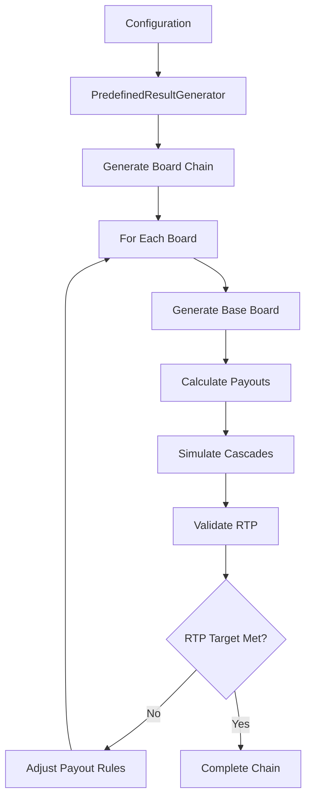

# Predefined Results System

A comprehensive system for generating predefined board chains with configurable RTP (Return to Player) for cascading slot games.

## Overview

The Predefined Results System ensures that players get a consistent and balanced gaming experience by pre-generating board sequences that meet specific mathematical requirements:

- **Configurable Board Count**: Generate 100-150 boards (or any custom amount)
- **Target RTP**: Ensure 97% RTP (or any custom percentage)
- **Mathematical Balance**: Guarantee that if a player has 100 coins, they can play exactly 120 rounds
- **Cascading Support**: Full support for cascade mechanics with multipliers

## Key Features

### 🎯 **RTP Management**

- Target RTP with configurable tolerance (e.g., 97% ± 1%)
- Automatic win distribution balancing
- Real-time RTP tracking and adjustment

### 🎰 **Advanced Payout System**

- Cluster-based win detection (adjacent matching symbols)
- Symbol-specific payout rules
- Multiplier integration with cascading mechanics
- Exponential scaling for larger clusters

### ⚡ **Cascade Simulation**

- Full cascade sequence simulation
- Symbol gravity and refill mechanics
- Multiplier persistence through cascades
- Maximum cascade limits for balance

### 📊 **Validation & Analytics**

- Hit frequency tracking
- Win distribution analysis
- Variance calculations
- Generation performance metrics

## Quick Start

### Basic Usage

```typescript
import { generateDemoChain, generatePredefinedChain } from "sc-slot-board-generator";

// Generate a quick demo (10 boards)
const demoChain = await generateDemoChain();
console.log(`RTP: ${(demoChain.rtpResult.actualRTP * 100).toFixed(2)}%`);

// Generate a full production chain
const productionChain = await generatePredefinedChain({
  boardCount: 120,
  targetRTP: 0.97,
  betSize: 1,
  playerBudget: 100,
  tolerance: 0.01, // ±1%
});
```

### Advanced Configuration

```typescript
import { PredefinedResultGenerator, Difficulty } from "sc-slot-board-generator";
import defaultDefinition from "sc-slot-board-generator/lib/default-definition";

const generator = new PredefinedResultGenerator(defaultDefinition.boardSettings, defaultDefinition.multiplier, Difficulty.Hard);

const chain = await generator.generateChain({
  boardCount: 150,
  targetRTP: 0.95,
  betSize: 2,
  playerBudget: 200,
  difficulty: Difficulty.Hard,
  maxRetries: 15,
  tolerance: 0.005, // ±0.5%
});
```

## Architecture

### Core Components

```
PredefinedResultGenerator
├── PayoutCalculator     # Win detection & payout calculation
├── RTQController       # RTP management & validation
└── BoardGenerator      # Board & cascade generation
```

### Data Flow



## Configuration Options

### PredefinedChainConfig

| Parameter      | Type       | Description                  | Example             |
| -------------- | ---------- | ---------------------------- | ------------------- |
| `boardCount`   | number     | Number of boards to generate | `120`               |
| `targetRTP`    | number     | Target RTP (0.0 - 1.0)       | `0.97`              |
| `betSize`      | number     | Coins per round              | `1`                 |
| `playerBudget` | number     | Starting budget              | `100`               |
| `difficulty`   | Difficulty | Game difficulty level        | `Difficulty.Medium` |
| `maxRetries`   | number     | Max generation attempts      | `10`                |
| `tolerance`    | number     | RTP tolerance (±)            | `0.01`              |

## Payout Rules

### Default Symbol Payouts

| Symbol | Min Count | Base Multiplier | Description        |
| ------ | --------- | --------------- | ------------------ |
| 0-2    | 3         | 0.1-0.3x        | Low value symbols  |
| 3-4    | 3         | 0.4-0.5x        | Medium-low symbols |
| 5-6    | 3         | 0.8-1.2x        | Medium symbols     |
| 7-8    | 3         | 2.0-5.0x        | High value symbols |
| 9      | 3         | 10.0x           | Premium symbol     |
| 10     | -         | -               | Multiplier symbol  |

### Win Calculation

```typescript
// Base win calculation
const countMultiplier = Math.pow(1.5, cluster.count - rule.minCount);
const baseWin = rule.baseMultiplier * countMultiplier * betSize;

// With multipliers
const totalMultiplier = appliedMultipliers.reduce((a, b) => a * b, 1);
const finalWin = baseWin * totalMultiplier;
```

## Examples

### Basic Example: Player Journey

```typescript
// Configuration: 100 coins, 120 rounds, 97% RTP
const chain = await generatePredefinedChain({
  boardCount: 120,
  targetRTP: 0.97,
  betSize: 1,
  playerBudget: 100,
});

// Simulate gameplay
let coins = 100;
for (const board of chain.boards) {
  coins -= 1; // Place bet
  coins += board.totalCascadeWin; // Add winnings
}

console.log(`Final coins: ${coins.toFixed(2)}`);
// Expected: ~97 coins (97% RTP)
```

### Export/Import for Game Integration

```typescript
// Generate and export
const chain = await generatePredefinedChain(config);
const jsonData = generator.exportChainToJSON(chain);

// Save to file or database
await fs.writeFile("game-sequence.json", jsonData);

// Later, load in game
const gameData = await fs.readFile("game-sequence.json", "utf8");
const loadedChain = generator.loadChainFromJSON(gameData);

// Use in game
function getNextBoard(roundNumber) {
  return loadedChain.boards[roundNumber];
}
```

## Advanced Features

### Custom Payout Rules

```typescript
const payoutCalculator = new PayoutCalculator();
payoutCalculator.updatePayoutRules([
  { symbol: 0, minCount: 3, baseMultiplier: 0.2, cascadeMultiplier: 1.1 },
  { symbol: 1, minCount: 3, baseMultiplier: 0.4, cascadeMultiplier: 1.2 },
  // ... custom rules
]);
```

### RTP Monitoring

```typescript
const rtpResult = rtpController.validateRTP(boards);
console.log({
  actualRTP: rtpResult.actualRTP,
  meetsTarget: rtpResult.meetsTarget,
  hitFrequency: rtpResult.hitFrequency,
  variance: rtpResult.variance,
});
```

### Win Distribution Analysis

```typescript
const distribution = analyzeWinDistribution(chain.boards);
// {
//   noWin: 0.65,     // 65% no win
//   smallWin: 0.25,  // 25% small wins
//   mediumWin: 0.08, // 8% medium wins
//   bigWin: 0.015,   // 1.5% big wins
//   megaWin: 0.005   // 0.5% mega wins
// }
```

## Testing

Run the comprehensive test suite:

```bash
npm test tests/predefined-results.test.ts
```

Run the interactive example:

```bash
npx ts-node examples/predefined-results-example.ts
```

## Performance

### Generation Speed

- **Demo chain (10 boards)**: ~50-200ms
- **Production chain (120 boards)**: ~1-5 seconds
- **Large chain (150 boards)**: ~2-8 seconds

### Memory Usage

- **120 boards**: ~2-5MB JSON export
- **Efficient cascade simulation**: O(n) complexity
- **Optimized RTP tracking**: Minimal overhead

## Best Practices

### 1. **RTP Tolerance**

```typescript
// Recommended tolerances
const configs = {
  development: { tolerance: 0.05 }, // ±5% for fast testing
  staging: { tolerance: 0.02 }, // ±2% for validation
  production: { tolerance: 0.01 }, // ±1% for accuracy
};
```

### 2. **Board Count Optimization**

```typescript
// Optimal board counts for different scenarios
const boardCounts = {
  quickTest: 10, // Fast validation
  demo: 50, // Demo purposes
  standard: 120, // Standard gameplay
  extended: 150, // Extended sessions
};
```

### 3. **Error Handling**

```typescript
try {
  const chain = await generatePredefinedChain(config);
  if (!chain.rtpResult.meetsTarget) {
    console.warn(`RTP target missed: ${chain.rtpResult.actualRTP}`);
  }
} catch (error) {
  console.error("Generation failed:", error);
  // Fallback to random generation
}
```

## Troubleshooting

### Common Issues

**Q: RTP target not met after maximum retries**

```typescript
// Solution: Increase tolerance or maxRetries
const config = {
  ...baseConfig,
  tolerance: 0.02, // Increase from 0.01
  maxRetries: 20, // Increase from 10
};
```

**Q: Generation too slow**

```typescript
// Solution: Reduce board count or increase tolerance
const config = {
  ...baseConfig,
  boardCount: 100, // Reduce from 150
  tolerance: 0.015, // Increase slightly
};
```

**Q: Variance too high/low**

```typescript
// Solution: Adjust payout rules
const newRules = payoutCalculator.getPayoutRules().map((rule) => ({
  ...rule,
  baseMultiplier: rule.baseMultiplier * 0.9, // Reduce variance
}));
payoutCalculator.updatePayoutRules(newRules);
```

## Integration Guide

### 1. **Backend Integration**

```typescript
// Generate chains offline
const chains = await Promise.all([generatePredefinedChain(easyConfig), generatePredefinedChain(mediumConfig), generatePredefinedChain(hardConfig)]);

// Store in database
await database.storeGameSequences(chains);
```

### 2. **Game Client Integration**

```typescript
// Load sequence at game start
const sequence = await gameAPI.getSequence(playerId, difficulty);
let currentRound = 0;

function playRound() {
  const board = sequence.boards[currentRound];
  const result = simulatePlayerSpin(board);
  currentRound++;
  return result;
}
```

### 3. **Analytics Integration**

```typescript
// Track actual vs predicted performance
const analytics = {
  predictedRTP: chain.rtpResult.actualRTP,
  actualRTP: calculateActualRTP(playerResults),
  variance: calculateVariance(playerResults),
  hitFrequency: calculateHitFrequency(playerResults),
};
```

## API Reference

See the complete API documentation in the TypeScript definitions and inline JSDoc comments in the source code.

---

## Contributing

When contributing to the predefined results system:

1. **Maintain RTP accuracy** - All changes must preserve mathematical correctness
2. **Test thoroughly** - Add tests for new features
3. **Document changes** - Update this README for any API changes
4. **Performance** - Consider generation speed impacts

## License

Same as the main project license.
